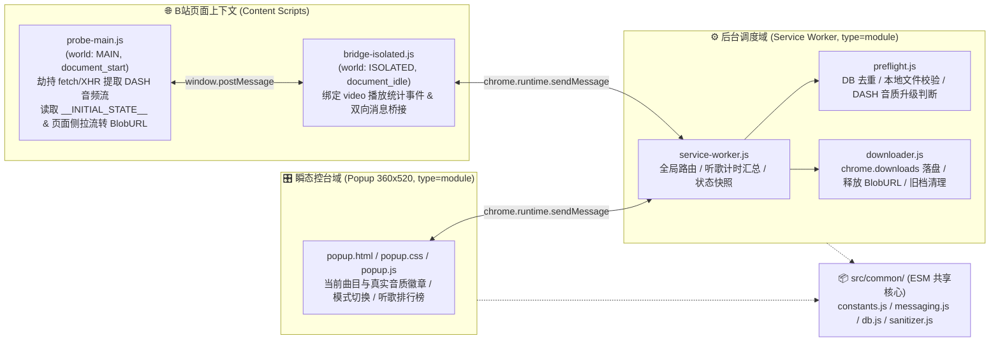

# 🏛️ BiliMusic - 系统架构与三域拓扑 (01_architecture.md)

本文档归档了 `BiliMusic`（`d:\music_addon`）Chrome Manifest V3 扩展的宏观技术选型、三域运行拓扑、工程目录职责边界与权限矩阵。

---

## 1. 📌 项目宏观概览 (Project Overview)

- **产品定位**：自动解析并捕获 Bilibili 音乐视频 **DASH 原始音频流**（无损 Hi-Res / 杜比 / 高码率 AAC 直下，零二次重编码损耗），支持音质升级自动替换、分 P 自动归档与本地听歌排行榜统计的 Chrome 扩展（MV3，`minimum_chrome_version: 116`）。
- **构建哲学**：**原生 ES Modules 零构建依赖**。无需 Webpack 或 Vite 打包，写完代码即可在 Chrome 开发者模式通过“加载已解压的扩展程序”直接调试。
- **捕获路线**：采用 **DASH 原流页面侧拉取 + `Blob URL` 落盘** 方案。彻底砍掉臃肿的 `tabCapture` 实时内录、`Offscreen` 双回路 Web Audio 与 `ebml-fixer` 后处理，实现**真原盘音质、几秒极速落盘、不受倍速/拖动/卡顿影响、无需手势授权全自动静默运行**。

---

## 2. 🏛️ 三域运行时拓扑 (MV3 Three-Domain Architecture)

---

## 3. 📂 目录结构与模块边界

| 目录 / 文件 | 运行上下文 | 模块规范 | 核心职责 |
| :--- | :--- | :--- | :--- |
| `manifest.json` | 全局清单 | JSON (MV3) | 声明精简权限（`downloads`, `storage`, `tabs`）、主机白名单与双世界注入规则 |
| `assets/icons/` | 扩展图标 | PNG (16/48/128) | 插件三态图标（待机灰、自动捕获红、纯统计绿） |
| `src/common/` | SW / Popup | ES Modules | `constants.js`、`messaging.js`、`db.js`、`sanitizer.js` |
| `src/content/` | B站页面 (`video/*`, `list/*`) | **独立单文件（禁止 ESM）** | `probe-main.js`（主世界拦截与拉流）与 `bridge-isolated.js`（隔离世界桥接与播放统计） |
| `src/background/` | Service Worker | ES Modules | 消息中枢、听歌时长结算、预检去重、音质升级判断、下载落盘与旧文件清理 |
| `src/popup/` | Extension Popup | ES Modules | `360x520` 双 Tab 控台（Tab 1 曲目音质与下载控制 / Tab 2 本地听歌排行榜） |

---

## 4. 🔐 权限与配置职责矩阵

| 配置项 / 权限 | 所属分类 | 核心用途 |
| :--- | :--- | :--- |
| `downloads` | API 权限 | 将 DASH 音频 `Blob URL` 按清洗后的子目录归档落盘，并查询校验本地文件是否被误删 |
| `storage` | API 权限 | 访问 `local` 用户配置（工作模式、自动下载开关）与 `session` 当前标签页曲目快照 |
| `tabs` | API 权限 | 获取当前激活 B 站标签页状态、向指定 `tabId` 下发拉流与释放 `Blob URL` 指令 |
| `*://*.bilibili.com/*` | 主机权限 | 允许扩展侧识别与交互 B 站视频页、享单/合集页接口 |
| `*://*.hdslb.com/*` | 主机权限 | 允许 Popup 控台与排行榜稳定加载 B 站视频封面缩略图 |
| `world: "MAIN"` | 注入配置 | 允许 `probe-main.js` 在 `document_start` 劫持 `playurl` 请求、读取 `__INITIAL_STATE__` 并以原站天然 `Referer` 拉取 CDN 音频流 |
